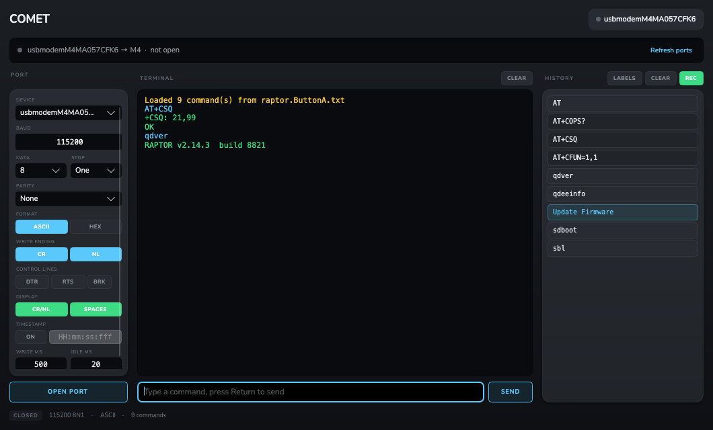

# COMET for macOS

A macOS port of [COMET](https://github.com/sqratchsix/COMET), the RS-232 serial terminal
that builds a UI for a device in real time. Each command you send becomes a history
button you can click to resend, and plain text files define reusable command sets for
a device.

The original is a .NET Framework 4.8 WinForms application and runs on Windows only.
This is a rewrite of the UI in [Avalonia](https://avaloniaui.net) on .NET 10, with the
serial and file logic ported across. It builds a native Apple Silicon `.app`.



The interface follows the same design language as
[mmyyxx](https://github.com/sqratchsix/mmyyxx) — raised panels over recessed
wells, hairline borders, small tracked-uppercase labels, and chips tinted by
what they do: accent for what goes on the wire, green for what only changes the
view, amber for the hardware control lines.

## Building

Requires the .NET 10 SDK. If `dotnet` is not on your path:

```bash
curl -fsSL https://dot.net/v1/dotnet-install.sh | bash -s -- --channel LTS
export DOTNET_ROOT="$HOME/.dotnet"
export PATH="$DOTNET_ROOT:$PATH"
```

Then:

```bash
scripts/build-app.sh          # produces build/COMET.app
open build/COMET.app
```

For day to day work:

```bash
dotnet run --project src/Comet.Desktop     # run from source
dotnet test                                # run the test suite
```

`dotnet run` needs an unlocked screen. macOS will not give a GUI process a display
link while the session is locked, and Avalonia fails to start its render timer if it
cannot get one.

## Layout

```
src/Comet.Core             Serial I/O, port discovery, data formatting, history file
                           format. No UI dependencies, no platform-specific code beyond
                           the macOS port enumerator.
src/Comet.Desktop          Avalonia UI: main window, view model, app bundle entry point.
src/Comet.Desktop/Themes   Colour tokens and control styles.
tests/                     xUnit tests, including serial round trips over a pseudo terminal.
tools/Comet.Shot           Renders the window off screen to a PNG. Used to review the
                           design without a display and to regenerate the screenshot.
scripts/build-app.sh       Publishes and assembles COMET.app.
build/                     Info.plist and the app icon; build output lands here too.
```

Regenerate the screenshot with:

```bash
dotnet run --project tools/Comet.Shot -- docs/comet.png
```

## What changed in the port

Most of the original is plain managed C# and moved across with only naming changes.
Four things genuinely could not:

**Port discovery.** The Windows build asked WMI (`Win32_PnPEntity`) to turn `COM3` into
`USB Serial Port (COM3)`. The macOS equivalent is the IOKit registry, read through
`ioreg`: each `IOSerialBSDClient` node carries the device path and its USB ancestor
carries the product name, so a CP2102 adapter shows up as
`usbserial-0001 – CP2102 USB to UART Bridge Controller`.

**Which device gets opened.** `SerialPort.GetPortNames()` returns the `/dev/tty.*`
dial-in devices on macOS. Opening one blocks until carrier detect asserts, which for
most USB adapters never happens, so the app would appear to hang. This build
enumerates and opens the `/dev/cu.*` call-out devices instead, and hides the `tty`
duplicates. USB adapters sort to the top of the list, ahead of the Bluetooth and
debug-console pseudo ports.

**How bytes are read.** The original hung off `SerialPort.DataReceived`, which on Unix
is backed by a polling loop that drops events under load. This build runs a dedicated
read loop on the port's `BaseStream` and keeps the original's idle-timer behaviour, so
a reply that arrives in several packets still reaches the terminal as one message. Data
is buffered as raw bytes and decoded on read, so switching between ASCII and HEX no
longer mangles bytes already in flight.

**Reveal in Finder.** `Process.Start(directory)` relied on Explorer. Here it is
`open -R`.

Two deliberate behaviour changes:

- **History order.** The Windows build stacks buttons upward from the bottom, which
  means a loaded command file reads bottom to top. Here entries keep the order they
  appear in the file and new commands append at the end, so a hand written command
  list reads the way it was written.
- **Text encoding.** ASCII mode decodes as Latin-1 rather than 7-bit ASCII, so bytes
  above 0x7F show as characters instead of turning into `?`. The two are identical for
  0x00–0x7F.

## Typeface

mmyyxx draws its labels in SF Rounded (`design: .rounded`). macOS hides that
family from font enumeration behind a dot-prefixed name, so Avalonia cannot
resolve it, and it is not redistributable in any case. The app ships
[Nunito](https://github.com/googlefonts/nunito) instead — the same humanist
geometry with rounded terminals, under SIL OFL 1.1, so it renders identically on
any machine. The five static weights in `src/Comet.Desktop/Assets/Fonts` were
instanced from the upstream variable font, since Avalonia applies weights from
named faces rather than a variable axis. The licence sits beside them.

## History file format

Unchanged from the original, so files move between the two builds in either direction:

```
<COMMAND><TAB><TAB><TAB><TAB><DESCRIPTION>
```

Runs of tabs collapse to one separator. A line with only a command uses the command as
its own description. A blank line toggles the button shade, which is how the command
files in the original repo's `COMMANDS` folder group related commands. Lines beginning
with `**` are script markers.

The command files from the original repo load unchanged — `ButtonB.txt` (97 entries,
2 scripts), `raptor.ButtonA.txt` (26 entries, 9 scripts), and the `COMMANDS` folder
were all used to verify this.

Drop a `.txt` file or a folder of them onto the window to load its commands.

## Status

Working:

- Port discovery with friendly USB device names and a refresh button; paired Bluetooth
  ports are hidden
- Quectel and similar modems: their USB AT ports are listed and opened through libusb,
  with no driver to install
- Open and close, with baud, parity, data bits and stop bits; any baud rate can be typed
- Terminal send and receive, colour coded, with per-line timestamps that can be shown
  or hidden at any time; status messages go to the footer, never the terminal
- ASCII and HEX modes, byte spacing, CR and NL write options, read line breaking
- DTR (on by default), RTS and send break
- Smart buttons that build up from the bottom as commands are sent; A, B, C and D load
  `ButtonA.txt` to `ButtonD.txt`; Load Commands lists the command files beside the app
- Script buttons: run, stop, a step editor with a text view, and a Script Commands table
- Load, append and save history files; drag and drop; reveal in Finder
- Several windows, each on its own port
- Right-click menus on the terminal, the smart button panel and the window
- Command recall in the input box with the up and down arrows

Not ported yet, all present in the Windows build:

- XModem and YModem transfer (`Transfer.cs` in the original)
- ToolBox, Convertor and the response analyzer windows
- Open All Ports, Tile and Close Other Instances
- The dialog for editing a command button
- Auto-loading `COMET.ini` at startup

## License

MIT, see [LICENSE](LICENSE). Free to use, change and redistribute, including in
commercial products, as long as the copyright notice and licence travel with it.
